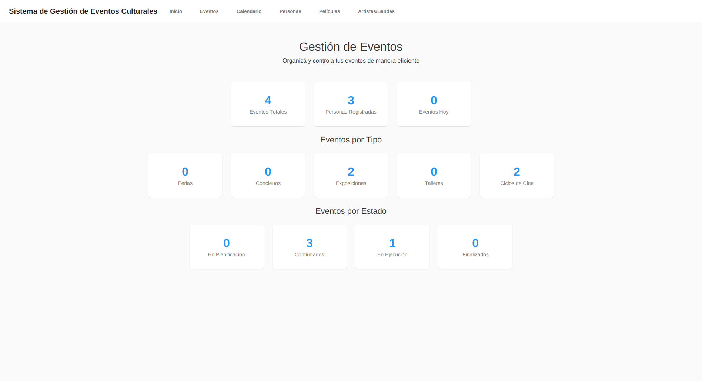
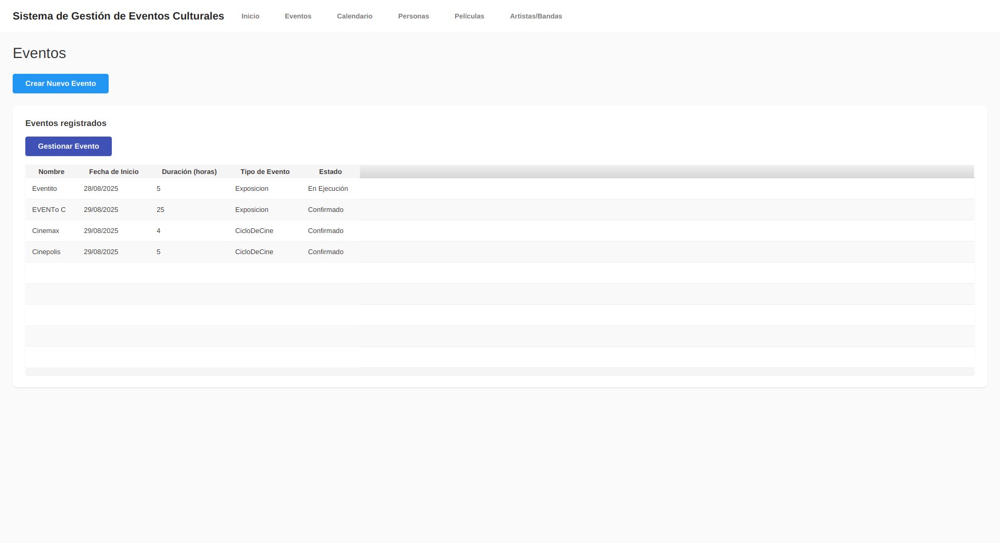
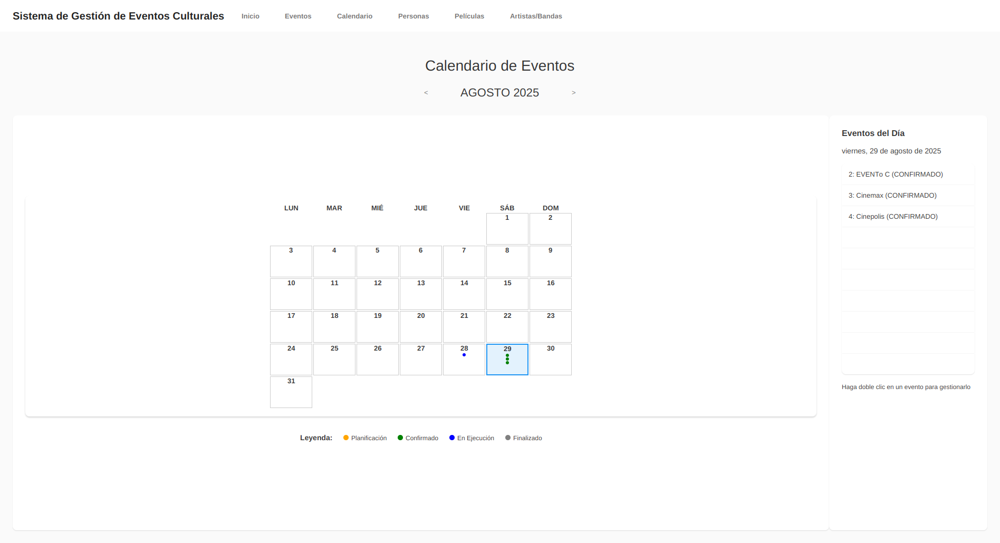

# Gestor de Eventos Municipales

Aplicación de escritorio para administrar eventos culturales municipales, sus responsables y asistentes. Permite organizar ferias, conciertos, exposiciones, talleres y ciclos de cine, con reglas para las inscripciones, los cupos y el ciclo de vida de cada evento.

Desarrollada íntegramente por [Marcos Daubermann](https://github.com/projectmarc), desde el modelo de dominio y la persistencia hasta la interfaz gráfica.

**Java 21 · JavaFX · JPA/Hibernate · H2 · Maven**



<details>
<summary>Ver más pantallas</summary>

### Gestión de eventos



### Calendario



</details>

## Qué permite hacer

- Crear y gestionar distintos tipos de eventos culturales.
- Administrar personas, artistas y bandas, y películas.
- Asignar responsables e inscribir asistentes con validación de roles y cupos.
- Gestionar el paso de planificación a confirmación, ejecución y finalización.
- Consultar los eventos desde una vista de calendario.
- Guardar la información localmente en una base de datos H2.

## Ejecutar localmente

### Requisitos

- JDK 21 y Maven instalados, con `JAVA_HOME` apuntando al JDK.
- Un entorno de escritorio para abrir la interfaz JavaFX.
- Acceso a Internet para descargar las dependencias en la primera ejecución.

Comprobá el entorno con `java -version` y `mvn -version`. El proyecto configura la compilación para Java 21; las versiones de sus dependencias están en [`pom.xml`](pom.xml).

```bash
git clone https://github.com/projectmarc/gestor-eventos-municipales.git
cd gestor-eventos-municipales
mvn clean compile
mvn javafx:run
```

### Datos locales

La conexión utiliza `jdbc:h2:file:./data/municipio-db` y Hibernate está configurado para actualizar el esquema al iniciar. No hace falta instalar un servidor de base de datos independiente.

El repositorio incluye el archivo `data/municipio-db.mv.db`: al ejecutar desde la raíz del proyecto se utiliza esa base existente. La aplicación puede modificarla, por lo que conviene trabajar sobre una copia si querés conservar su contenido original. No se requiere borrar datos para ejecutar el proyecto.

La configuración está en [`persistence.xml`](src/main/resources/META-INF/persistence.xml).

## Reglas de negocio

Las reglas comunes se encuentran en la clase [`Evento`](src/main/java/gov/municipio/domain/model/evento/Evento.java), y cada tipo de evento define los roles admitidos y los responsables necesarios para confirmarlo.

| Operación | Condiciones del modelo |
| --- | --- |
| Agregar o quitar responsables | El evento debe estar en planificación. |
| Confirmar un evento | Debe contar con los roles responsables obligatorios para su tipo. |
| Inscribir un asistente | El evento debe requerir inscripción y estar confirmado o en ejecución. |
| Controlar el cupo | Se cuentan los asistentes, no los responsables. |
| Evitar participaciones duplicadas | Una persona no puede participar dos veces en el mismo evento. |
| Quitar un asistente | No se permite si el evento ya finalizó. |

El flujo principal es:

```text
Planificación → Confirmado → En ejecución → Finalizado
```

El modelo también permite volver de **Confirmado** a **Planificación**. Valida nombres, fechas de inicio no anteriores al día actual, duración y cupos al asignar esos valores.

## Organización del código

El proyecto separa el dominio, los servicios de aplicación, la persistencia y la interfaz:

```text
src/main/java/gov/municipio/
├── domain/         # Entidades, reglas de negocio y excepciones
├── application/    # Servicios de aplicación
├── persistence/    # Repositorios y configuración de JPA
├── controller/     # Controladores de las pantallas JavaFX
├── ui/             # Navegación entre pantallas
└── config/         # Contenedor de servicios
```

Las vistas FXML y los estilos CSS están en [`src/main/resources/gov/municipio/view/`](src/main/resources/gov/municipio/view/).

### Aspectos técnicos para explorar

- **Herencia y polimorfismo:** `Evento` reúne el comportamiento compartido; `Feria`, `Concierto`, `Exposicion`, `Taller` y `CicloDeCine` representan los distintos tipos de eventos.
- **Reglas dentro del dominio:** las operaciones de participación y cambio de estado validan sus condiciones en el modelo, no solamente en los formularios.
- **Mapeo relacional:** JPA utiliza la estrategia `JOINED` para persistir la jerarquía de eventos y relaciones entre eventos y participaciones.
- **Interfaz separada en recursos:** JavaFX utiliza vistas FXML y estilos CSS para las pantallas de la aplicación.

## Alcance actual

Es una aplicación de escritorio con persistencia local, no una aplicación web ni una API REST. El repositorio no incluye actualmente una suite de pruebas automatizadas en `src/test`; compilar el proyecto no sustituye la verificación funcional de sus pantallas y reglas.

El diseño visual tiene margen de mejora, especialmente en la distribución del espacio y el tamaño de las columnas de las tablas.
